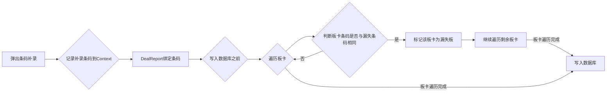

# 需求：条码漏失率
需要在拍照前扫码 条码枪扫码超时的时候，记录该板卡条码漏失至数据库

## 流程
1. 在弹出条码补录时，记录补录的条码 存入context
1. 在dealreport绑定完条码后，在写入数据库之前
1. 先遍历板卡 如果板卡的条码与漏失的条码相同，则将该板卡标记为漏失板

## 注意
1. 需要查看context的清除时机 到底是清除的，还是重新创建的

在每一次开始拍照时 new出的context

1. 不能向BarcodeManager中添加业务
Barcodemanager用作条码扫描的缓存记录，在其中加入业务会影响后续的开发，评估后仍写入context
