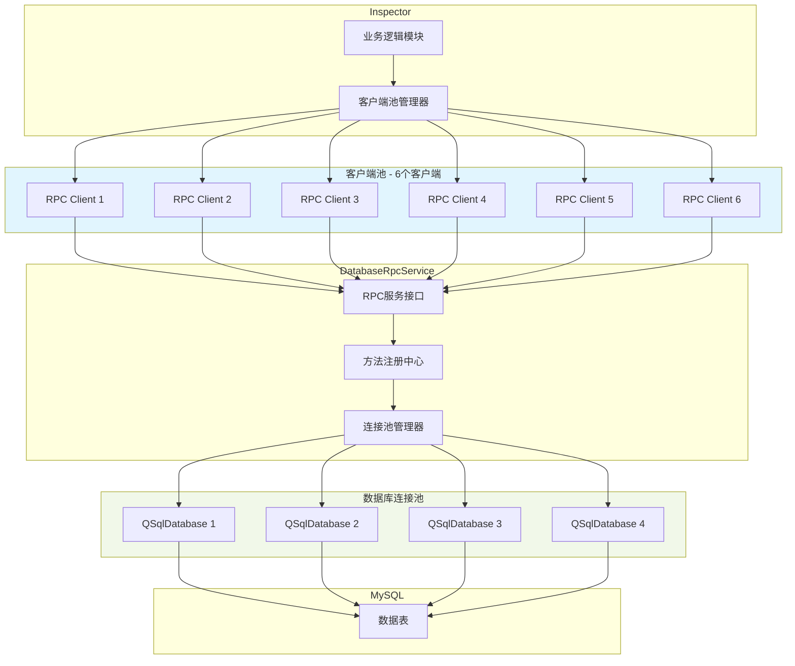
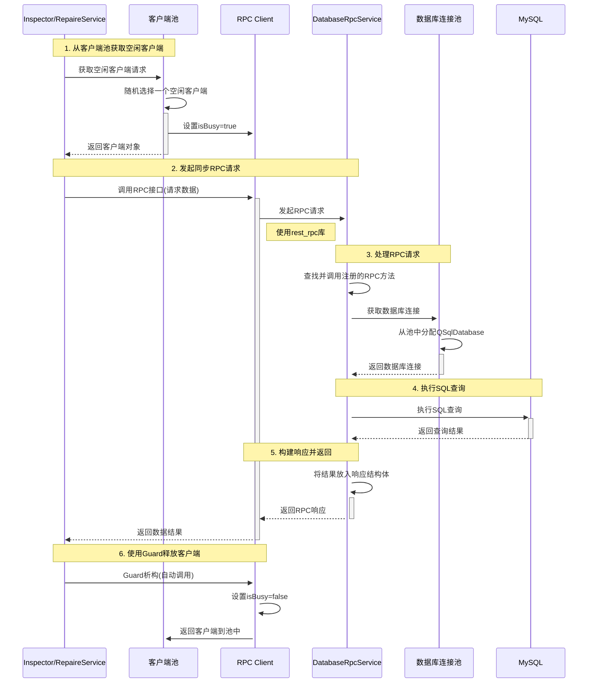
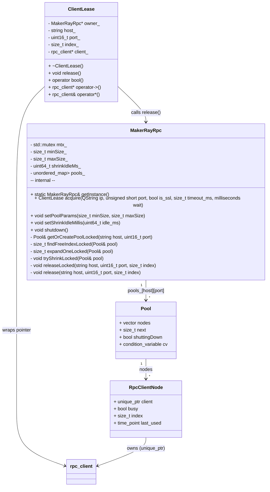
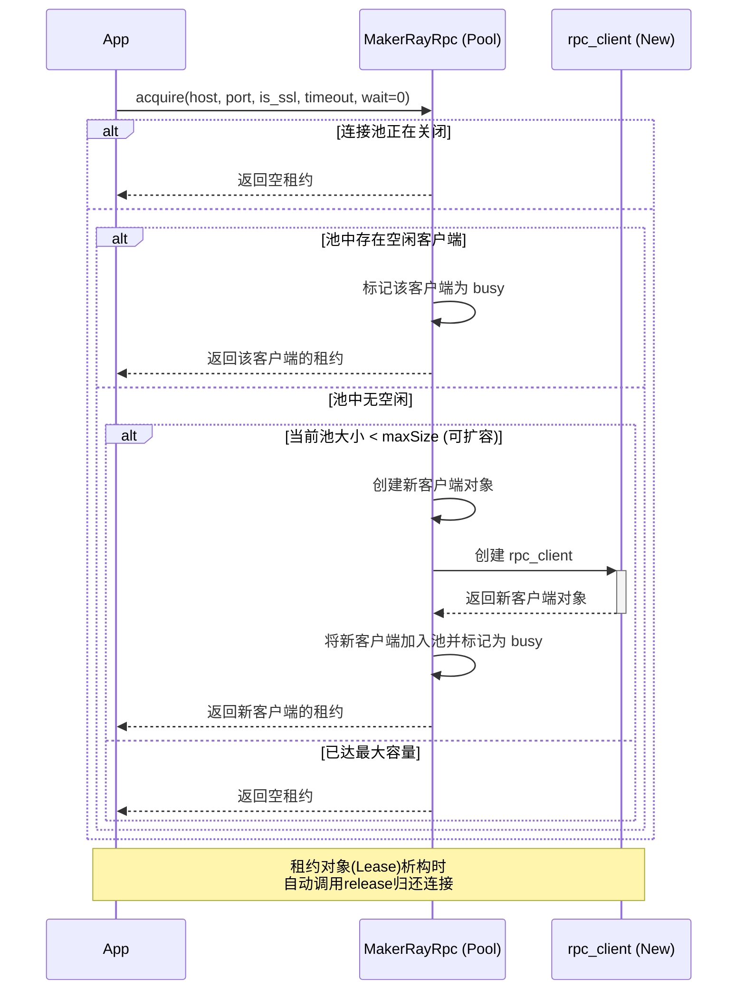
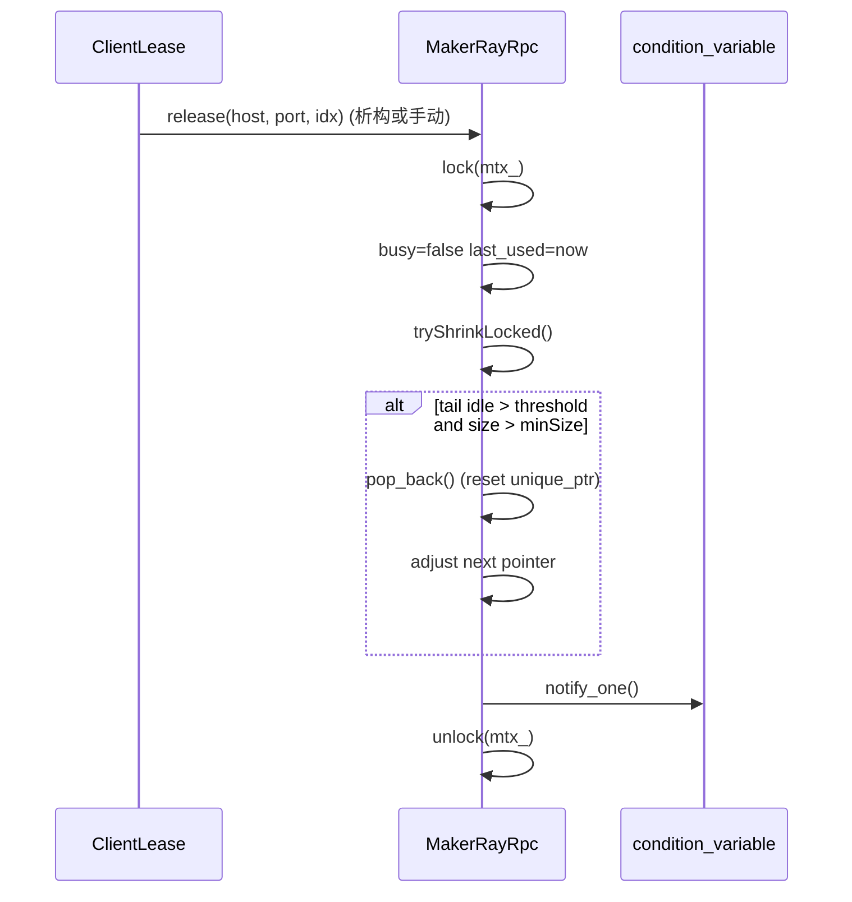

# 现有架构分析



当前架构大致分为四个模块组成：Inspector RepaireService DatabaseRpcService Mysql

## 1.Inspector和RepaireService

Inspector和RepaireService中有 rpcclient 通过发起同步rpc请求，调用DatabaseRpcService中的接口，实现数据的获取。

Inspector目前维护了一个client为6的客户端池，每次要获取数据时，先从池中随机拿取一个空闲的client，将标记位isbusy设置为true

拿到client对象后，同步调用rest_rpc的接口，发起rpc请求。请求完成后使用Guard，在client析构时，将标记位isbusy设置为false。

## 2.DatabaseRpcService

DatabaseRpcService在接收到请求后，接受请求的线程通过查找并调用在注册中心注册的RPC方法，完成整个RPC请求的调用。

在执行RPC方法时，从维护的连接池中，拿取一个QSqlDatabase对象，执行SQL查询,查询完成后，将所需的结果数据放入响应结构体，由rpc服务传回。

伪代码如下：

```C++
bool func() {
    QSqlDatabse db;
    do {
        CONNECTPOOL(db);
        ...
    }while(0);
    DISCONNECTPOOL(db);
    ...
}
```



# 现有问题分析

## 1.拿取不到client

当检测软件、维修站有查询请求时，经常出现无法获取到客户端的情况，从而导致当次的请求失败。

### 原因分析：

a) 检测软件维护了一个client池，上限是6个，当所有的连接都busy时，就会在日志中打印**get a busy client**，此时应该返回一个空对象，让上层处理，但是目前的代码是**继续返回一个busy的client**。

b) 在连接池的使用上，存在易用性差的问题

```cpp
bool DatabaseClient::queryProjectInfos(QMap<int, AoiProjectInfoRpc> &project_map)
 {
    //get client
    MakerRayRpcClient& rpcClient = MakerRayRpc::getInsance()->connect(m_ip, m_port);
    //callback set client status
    ScopeGuard guard([&rpcClient] { MakerRayRpc::getInsance()->setFreeStatus(rpcClient); });
    try {
        QueryProjectInfosResp result = rpcClient.client->call<timeout, QueryProjectInfosResp>("QueryProjectInfos", req);
        MakerRayRpc::getInsance()->setFreeStatus(rpcClient,true);
    } cache (...) {
        //manual set status
        MakerRayRpc::getInsance()->setFreeStatus(rpcClient,true);
    }
    ...
    //Destruction
}

```

原本手动就可以释放的连接，当出现异常时，手动释放，在多线程的环境下，这个客户端被标记为可用，另一个线程立刻拿走了线程去使用，设置为busy状态，但是当到本函数结束，guard析构时，又会将这个连接设置为空闲，再让下一个线程可使用...

虽然是使用上的误用导致，但也从侧面体现出了我们rpcclient使用时的繁琐和复杂。

## 2.数据库连接数过大

databaserpcservice中，连接池的设计也存在问题

每次调用acquireDatabase函数，试图获取QSqlDatabase连接时，逻辑存在漏洞

原逻辑是：首先遍历map，获取可用的连接，如果没有可用的连接，就新建一个连接，然后放入map，当存在有连接没有释放的情况下，就会无限增长。

并且在Qt官方文档中，明确的表示了，**一个QSqlDatabase实例必须仅由创建它的线程访问。**

回顾旧的逻辑：当最开始连接池中没有连接时，此时客户端发起一个请求，工作线程处理请求，进入对应的接口后，创建一个QSqlDatabase实例，放入map并使用，使用完成后归还，下一次再次有请求进入，并不一定由上一次的工作线程处理，此时**从连接池中拿取的空闲连接是由上一个线程创建的实例。**

## 3.数据查询时间过长

a）在现有的sql语句中，查询几乎都是“耿直”查询：

在统计信息，查找TopTen料号时，直接用大量的数据拼接sql语句：

查询语句如下：

按一个字符‘1’，占用两字节来算，一条66270个字符的SQL语句，占用129.43 KB

b）数据库服务部分语句会捞取大量数据，占用大量内存

c）sql语句查询很多与开始统计时间有关，当时间跨度大时，所扫描的行数多，耗时长。

一条语句，要从1000w的板卡表中查询时，全命中的情况下耗时10min+

## 4.流程中存在旧数据库逻辑

最新的检测软件已经将旧数据库屏蔽，但是在检测软件的执行流程中，仍存在很多流程会执行旧数据库的查询，但是后续又没有使用到查询的数据，浪费性能。

# 解决方案

针对上述问题，提出以下解决方案：

## 1.优化Client连接池

- 线程安全的获取/归还客户端连接（RAII ）
- 动态扩容（按需增长）与空闲收缩（回落到最小连接数）
- 轮询（round-robin）选择空闲连接
- 支持非阻塞获取或阻塞等待（带超时）

### 类图



MakerRayRpc：单例，负责管理所有连接池。

Pool：管理特定一个服务端点（host:port）的所有客户端连接

RpcClientNode：连接池中的单个item，包装了一个客户端并记录其状态

ClientLease：代表一个从池中租借出来的客户端。它管理着客户端的生命周期和归还。

### 时序图

#### 获取连接时序图



#### 归还连接

- 在 release 时尝试从尾部收缩（tryShrinkLocked）。

- 仅回收空闲且空闲时间超过 shrinkIdleMs_ 的尾部节点。

  PS:从尾部删除：因为获取client的方式是round-robin，如果删除是遍历所有超时的删除，则会导致index错乱，最小改动采用从尾部收缩。



### 对比

| 对比维度       | 旧版                                                         | 新版                                                         |
| -------------- | ------------------------------------------------------------ | ------------------------------------------------------------ |
| **获取策略**   | 轮询选择一个非 busy 客户端；若都 busy，可能返回 busy 客户端（存在并发踩踏风险）。 | 轮询选择空闲；若无空闲则尝试扩容；若达到上限则根据 wait 参数选择等待或失败；**绝不返回 busy 客户端**。 |
| **扩容与收缩** | 固定大小，无法扩容与收缩。                                   | 支持按需扩容到 maxSize；在释放时按尾部空闲时长收缩，回落到 minSize。 |
| **资源管理**   | 需手动 setFreeStatus，易忘记导致假忙；                       | **RAII **析构自动归还；                                      |
| **配置能力**   | 构造时固定大小。                                             | 可通过 **setPoolParams(minSize, maxSize)** 和 **setShrinkIdleMillis** 动态配置池大小和收缩策略。 |
| **使用方式**   | 将 `MakerRayRpc::connect` <br />旧: `auto& cli = ...connect(...); cli.client->call(...); setFreeStatus(...)` | 改为 `MakerRayRpc::acquire`，并持有返回的 `ClientLease`<br />新: `auto lease = ...acquire(...); if (lease) lease->call(...);` |

## 2.优化QSqlDatabse连接池

### 类图

```mermaid

```

由于QSqlDatabase实例必须仅由创建它的线程访问，所以使用Qt的QThreadStorage，保证每个线程（每个Service工作线程）有自己的连接桶，存贮有自己创建的QSqlDatabase连接。

QSqlDatabase的连接真实由QSqlDatabase内部实现的全局连接字典管理

### 时序图

```mermaid

```

###

## 3.优化数据查询方式

代办：

请求需要支持优先级，确保高优先sql‘语句’查询速度是快速的

分表按月可能存在浪费（数量不大）

将整板、分板分成两张表  （FAE 产品沟通使用 大部分是否使用整版统计）：如果做的话，规划两张表的字段，拼版的优化再计划

优势：

风险：

花费时长：

表结构：

问题：
索引：

整理语句

# 测试：

1.RPC同步调用，服务端响应处理，是同步还是异步

多线程同步调用时，客户端会同步调用，服务端工作线程充足时，并发执行，没有按照请求的先后顺序执行

2.客户端连接池测试用例

3.数据库连接池用例
