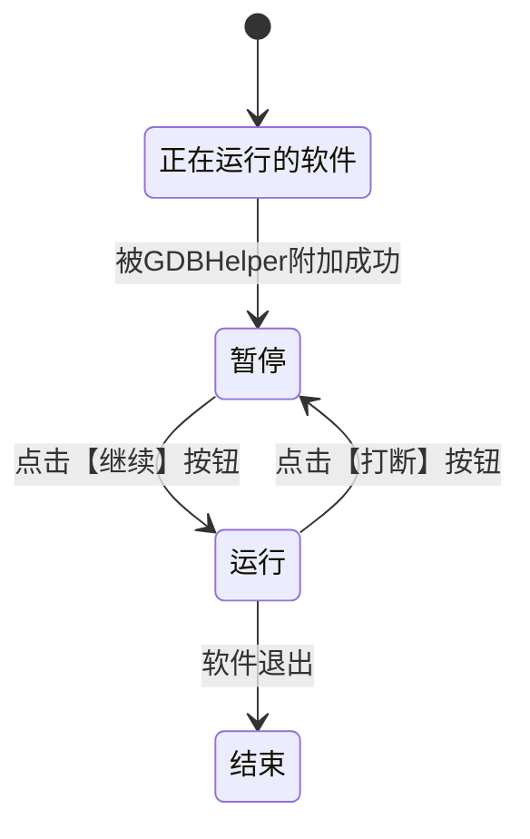
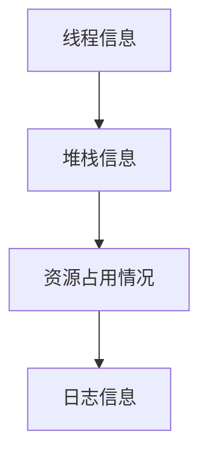

# GdbHelper使用SOP

## 概述

针对现阶段软件的卡顿、资源占用异常问题 **出现频率不高**，**复现难度大**等痛点，输出一个调试工具：

1.供FAE小伙伴更准确的收集“珍贵”的现场问题

2.采集到的日志供研发小伙伴更快地定位问题，为解决问题提供精准的数据支撑。

## 本工具可以调试哪些情况

1. 软件**卡顿**时的信息收集
2. 软件**闪退**时的coredump、堆栈信息保存
3. 软件**仅卡死**无crash时的现场保存
4. 软件导致的**资源（CPU）占用异常**信息收集
5. ....

## 工具基本使用介绍

### 工具栏

工具栏尽量做到简单，于是只保留了两个至关重要的按键：

【继续】：点击时可以使暂停中的软件继续运行（绿色状态表示软件运行中）

【打断】：点击后可以使运行中的软件暂停（红色状态表示软件暂停中）

软件的运行流程如下：

### 附加进程

首先点击①弹出进程选择界面，选择一个要附加的进程（以检测软件inspector为例）

选择完成后点击OK关闭界面，所选的进程号会被自动填入②

因为GDB附加其他正在运行的程序需要root权限，所以需要输入当前设备的root密码，**默认情况下是aoi2014 无需手动填写**

### 处理任务

点击OK后会自动执行一串命令附加至对应的进程，时间与软件的大小成正比（检测软件一般20~30s），耐心等待即可

### 显示所有线程详细信息

附加成功后，会自动执行命令获取当前进程的所有线程以及**所有线程**的**调用堆栈**

**请注意：此时被附加的软件处于暂停状态！！！不要重复点击被调试软件！！！**

**请注意：此时被附加的软件处于暂停状态！！！不要重复点击被调试软件！！！**

**请注意：此时被附加的软件处于暂停状态！！！不要重复点击被调试软件！！！**

此时可以选择

- 保存所有线程信息 ：包含上图中的线程信息 堆栈信息 执行指令的LOG信息

- 保存CoreDump

注意：CoreDump文件生成一般很大，在非常必要时再选择生成。

如果不需要保存当前的信息，需要继续运行软件，点击工具栏的 让软件继续运行

### 显示实时线程信息

软件运行时可以保存软件的实时线程信息

### 显示软件Log信息

LOG界面会记录GDB调试的输出信息 以及用户操作的命令输入信息，在出现意外情况时方便查看日志分析工具的bug，所以正常使用的情况下可以忽略不计

## 使用场景实例

### 软件卡死没有闪退

当出现卡死的时候，根据上述操作，附加至卡死的软件，等待进度条加载完成后，点击保存日志，即可收集卡死时的调用堆栈。

如下图所示：选择需要保存信息的目录即可，默认保存的文件名为 **gdb_info.txt**

日志结构如下：

###  软件单线程跑满

当发现软件出现CPU资源占用异常时，首先附加到对应的软件，然后点击【继续】，界面切换至【实时线程信息】，可以看到有一个线程占用CPU过高

此时点击【打断】

便可获取到资源占用异常时软件的线程以及调用堆栈

此时可以选择【保存日志】，如果日志无法分析出是何原因导致的，

“下下策”可以选择【保存CoreDump】文件，再提供对应的版本**哈希值** 丢给研发小伙伴处理

### 软件卡顿

软件卡顿与上述两次操作同理，只需要抓住软件卡顿的时间点，按下【打断】按钮，让软件暂停，就可以获取到软件卡顿时的信息。
