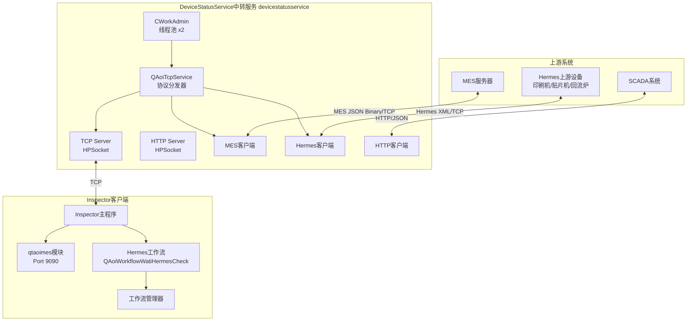
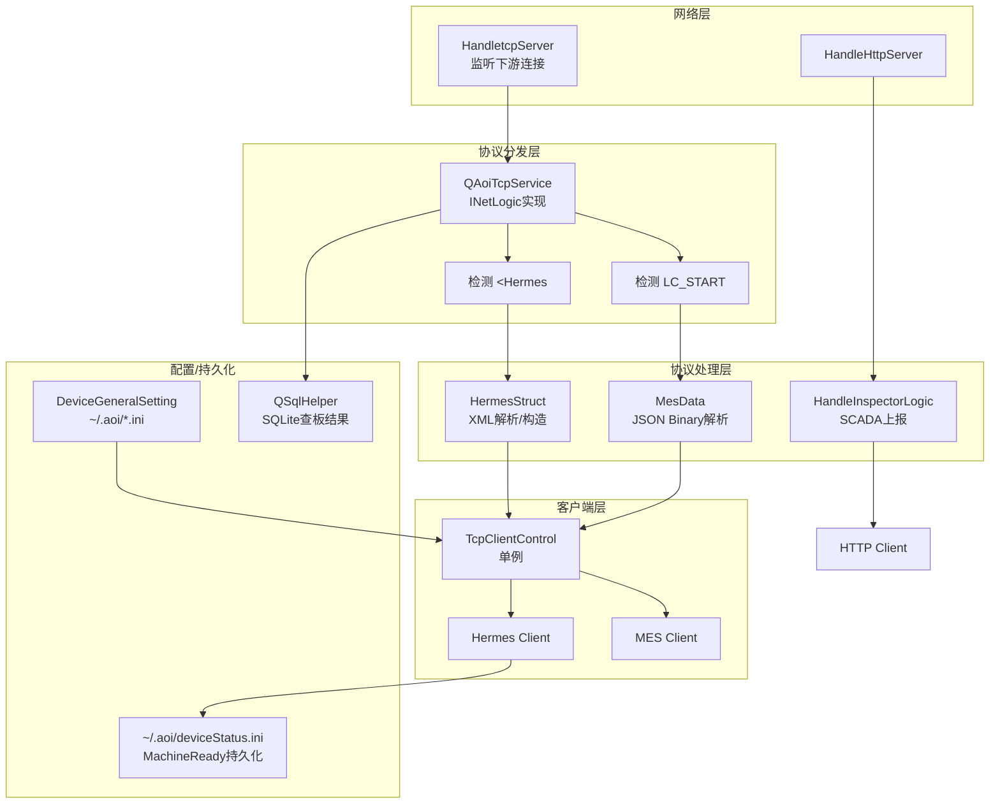
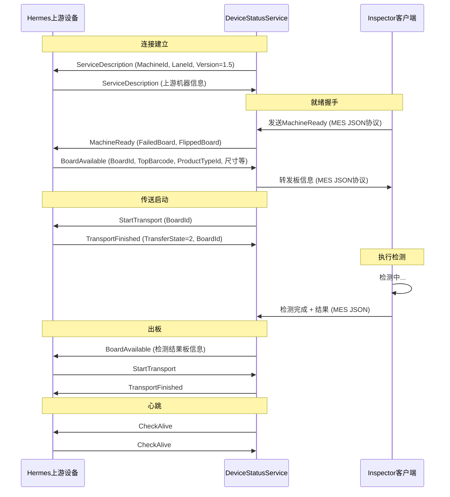
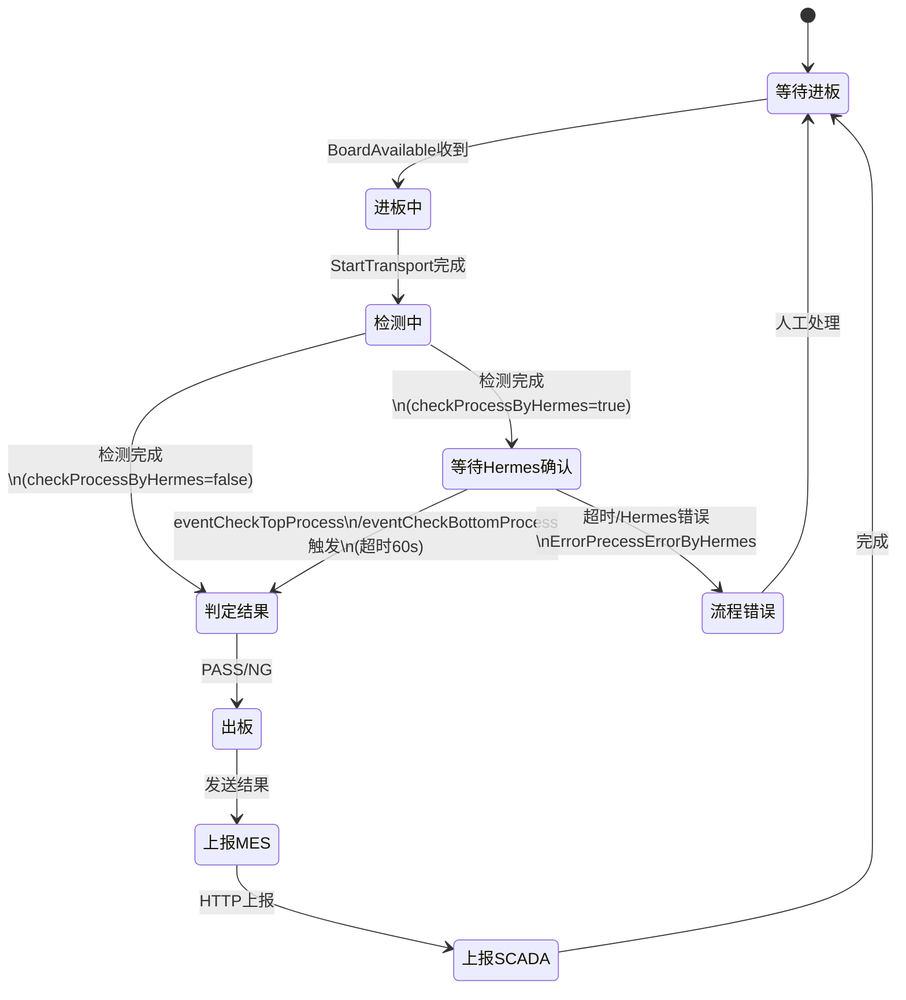
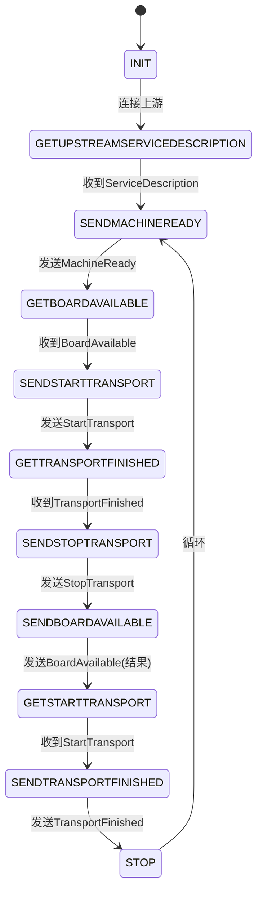

# IPC-Hermes 接入项目交接文档

## 一、系统总体架构



---

## 二、DeviceStatusService 内部架构



---

## 三、IPC-Hermes 协议流程



---

## 四、Inspector 检测工作流（Hermes相关）



---

## 五、设备状态机（DeviceStatus）



---

## 六、MES 数据包格式

```
+------------------+------------------+------------------+------------------+-------+
| LC_START (8字节)  | 消息长度 (4字节)  |   JSON Body      |  **** (4字节)    | \r\n  |
|    魔数           |   uint32         |   (变长)          |   结束符         |       |
+------------------+------------------+------------------+------------------+-------+
```

**JSON Body 关键字段：**

| 字段 | 说明 |
|---|---|
| `TYPE` | 消息类型（HEARTBEAT / DEVICESTATUSREPROT / RESULTREPROT 等） |
| `CONTENT` | 消息内容（JSON字符串，支持大包分片） |
| `CONTENTDESCRIBE` | 附加描述 |
| `PACKETTOTALCOUNT` | 分片总数 |
| `PACKETORDER` | 当前分片序号（0起） |

---

## 七、Hermes XML 消息类型

| 消息名 | 方向 | 说明 |
|---|---|---|
| `ServiceDescription` | 双向 | 连接后互报机器ID、Lane、版本 |
| `MachineReady` | DSS→上游 | 设备就绪，可接板 |
| `BoardAvailable` | 上游→DSS / DSS→上游 | 板信息（ID、条码、尺寸、子板） |
| `StartTransport` | 双向 | 启动传送 |
| `TransportFinished` | 双向 | 传送完成（TransferState: 0未开始/1未完成/2完成） |
| `StopTransport` | DSS→上游 | 停止传送 |
| `RevokeBoardAvailable` | 双向 | 撤销BoardAvailable |
| `RevokeMachineReady` | 双向 | 撤销MachineReady |
| `CheckAlive` | 双向 | 心跳 |
| `Notification` | 上游→DSS | 错误/警告通知 |

---

## 八、关键配置文件

| 配置项 | 位置 | 说明 |
|---|---|---|
| 服务端监听 | `~/.aoi/*.ini` | TCP服务端 IP/Port |
| MES地址 | `~/.aoi/*.ini` | MES服务器 IP/Port |
| Hermes地址 | `~/.aoi/*.ini` | Hermes上游设备 IP/Port |
| SCADA地址 | `~/.aoi/*.ini` | SCADA HTTP地址 |
| machineId/laneId | `~/.aoi/*.ini` | Hermes ServiceDescription中使用 |
| Hermes版本 | `~/.aoi/*.ini` | 当前 **1.5** |
| MachineReady持久化 | `~/.aoi/deviceStatus.ini` | 重启后恢复就绪状态 |

---

## 九、关键模块路径速查

| 模块 | 路径 |
|---|---|
| 中转服务源码 | `/home/aoi/DiskD/project/hermes/devicestatusservice/app/` |
| Inspector 客户端 | `/home/aoi/DiskD/project/inspector/code_view/inspector/` |
| Hermes XML结构定义 | `app/LogicTcp/hermesstruct.h` |
| MES包序列化/反序列化 | `app/LogicTcp/mesdata.*` |
| 协议分发核心（粘包处理） | `app/qaoitcpservice.cpp` |
| 设备状态机 | `app/tcp/handletcpserver.h` |
| Hermes客户端控制 | `app/tcp/tcpclientcontrol.*` |
| Hermes工作流（等待确认） | `src/libs/qtaoi/qtaoicontrol/src/aoicontrol/workflows/qaoiworkflowwatihermescheck.*` |
| 检测完成工作流管理器 | `src/libs/qtaoi/qtaoicontrol/src/aoicontrol/workflowmanagers/qaoiworkflowmanagerinspectionfinish.cpp` |
| MES控制器（Port 9090） | `src/libs/qtaoi/qtaoimes/src/aoimes/qaoimescontroller.*` |
| MES发送基类 | `src/libs/qtaoi/qtaoimes/src/aoimes/sendmes/qaoisendmes.h` |

---

## 十、已知问题与修复记录

| 提交 | 类型 | 说明 |
|---|---|---|
| `f1e8e86` | feature | 添加撤销到板命令（RevokeBoardAvailable） |
| `5c4337a` | bugfix | 修改日志输出，解决服务端发送粘包问题 |
| `e5b6208` | bugfix | 添加对 Notification 消息的解析及错误处理 |
| `88e0d3f` | bugfix | 修复因暂停检测软件导致的流程错误（不进板） |
| `b682f30` | bugfix | 修复粘包导致Hermes数据解析失败；持久化MachineReady；修复BoardAvailable解析错误 |
| `f444473` | feature | Hermes 1.5 版本支持 |
| `11d7d41e` | feature | Hermes换板型：ProjectID全匹配改为"前缀匹配" |
| `1bc02b04` | bugfix | 延长Hermes断连后重连等待时间 |
| `289f96ab` | bugfix | 修复换板型停止时机错误；修复双发StartTransport问题 |
