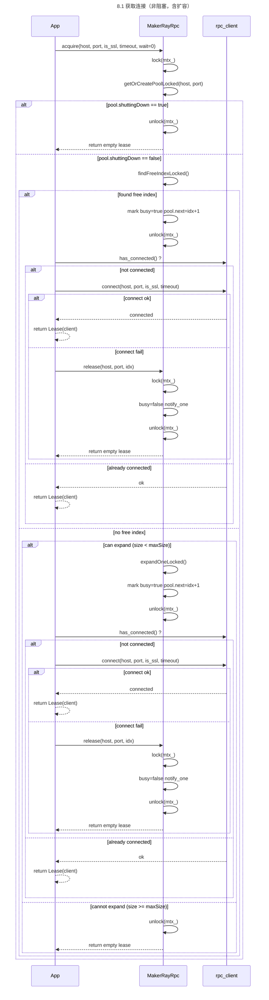
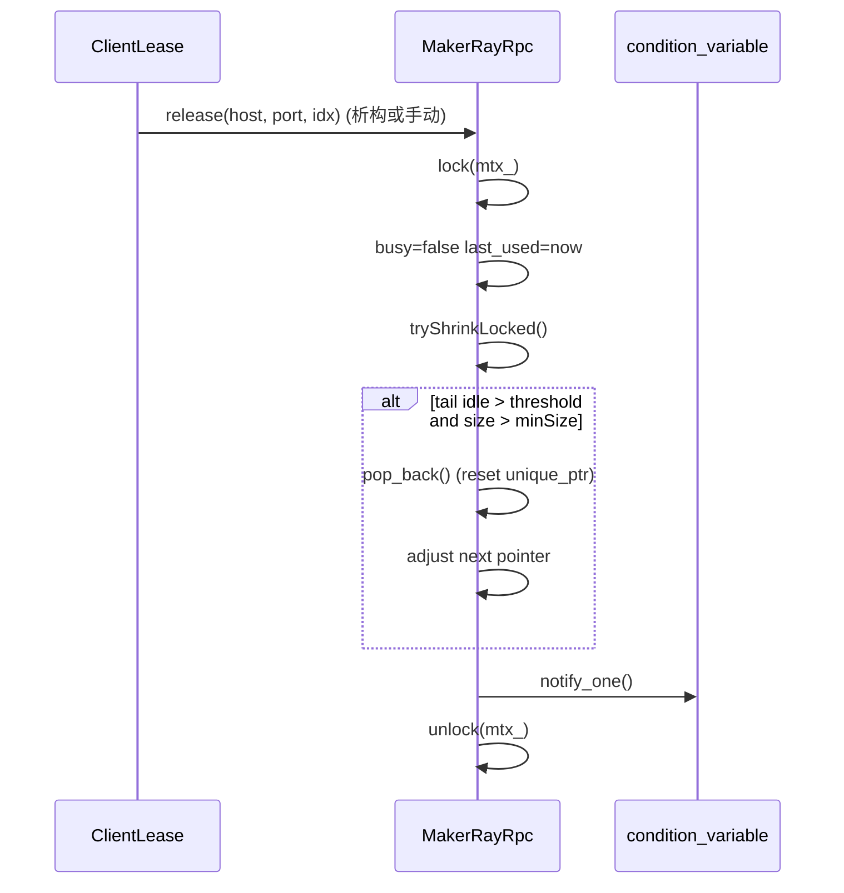
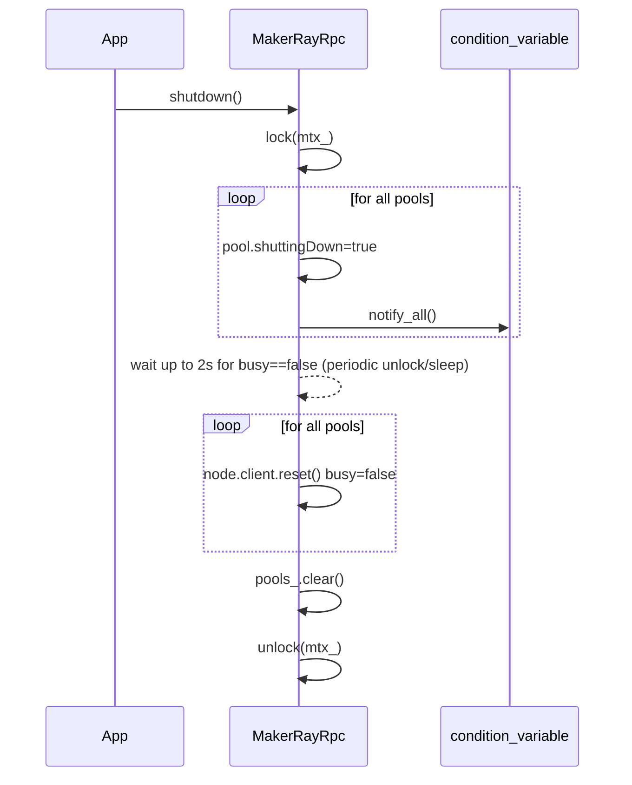
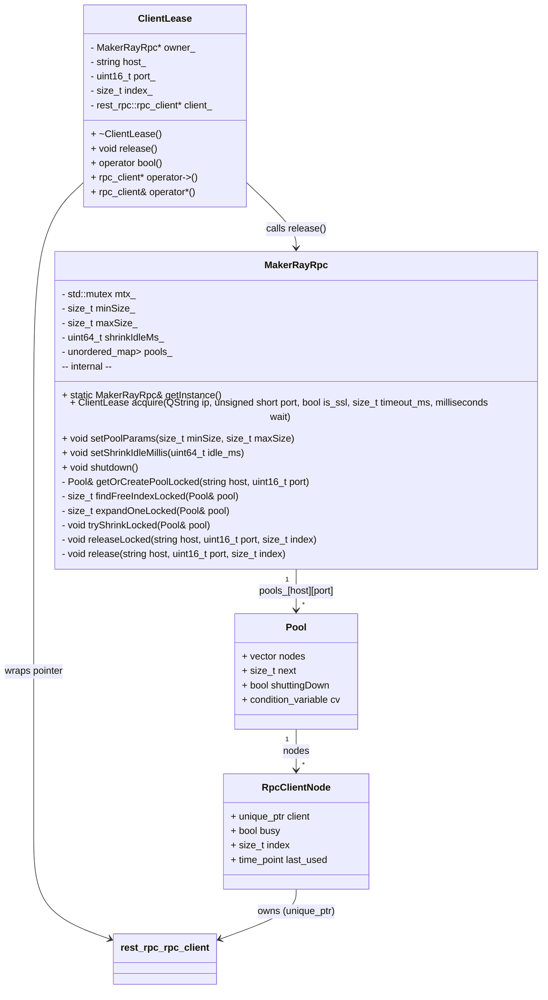
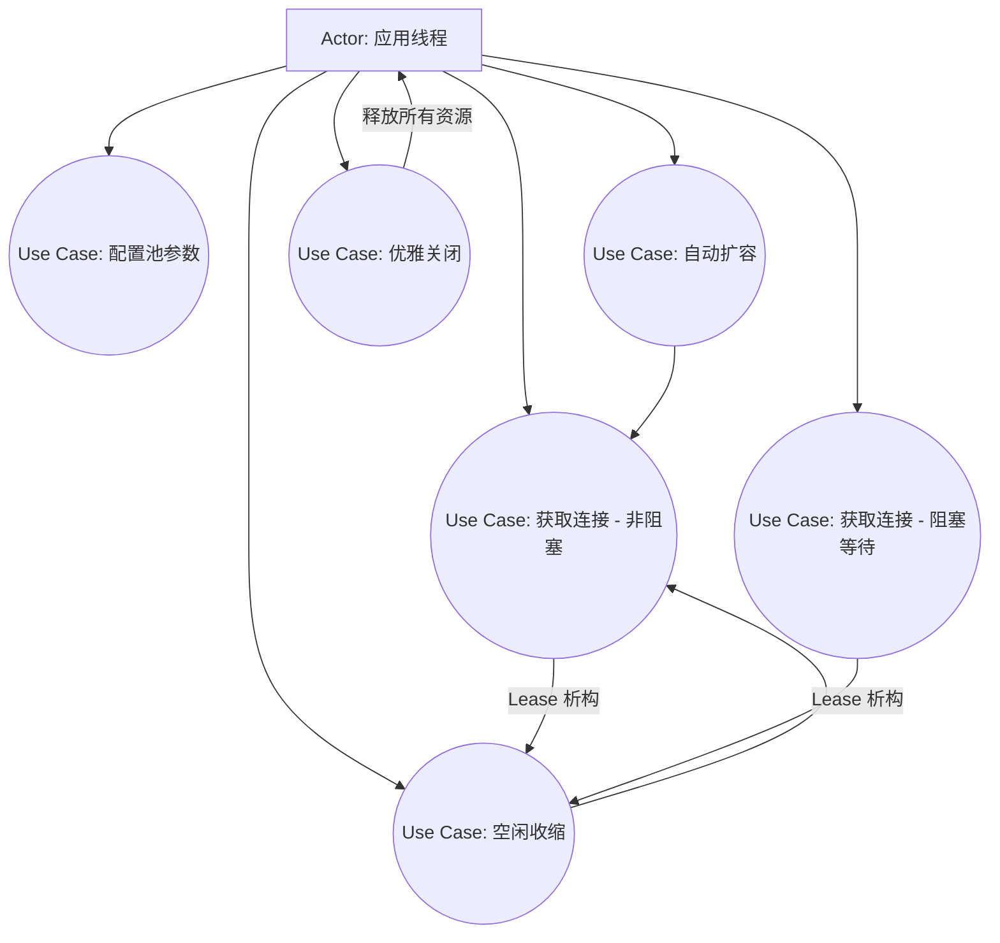

# MakerRayRpc 连接池设计文档

版本: 1.0
语言标准: C++11
依赖: rest_rpc::rpc_client, Qt (QString / QDebug), C++ 标准库 (unordered_map, vector, mutex, condition_variable, unique_ptr)

---

## 1. 概述

MakerRayRpc 是一个支持多主机多端口的 RPC 客户端连接池，提供以下特性：
- 线程安全的获取/归还客户端连接（RAII 租约）
- 动态扩容（按需增长）与空闲收缩（回落到最小连接数）
- 轮询（round-robin）选择空闲连接
- 支持非阻塞获取或阻塞等待（带超时）
- 优雅关闭（shutdown）
- 全局单例（按需访问）

该连接池适用于高并发调用 rest_rpc::rpc_client 的场景，保证在没有空闲连接时不会返回正在使用的连接，避免并发踩踏。

---

## 2. 需求与假设

- 功能性需求
  - 可针对 (host, port) 维度独立维护连接池。
  - 支持最小 minSize 和最大 maxSize 池大小配置，按需扩容。
  - 空闲连接在超过阈值 shrinkIdleMs 后从尾部回收，最终回落到 minSize。
  - 获取连接支持等待超时；若到达上限且无空闲，获取失败。
  - RAII 模式自动归还连接（ClientLease 析构时归还）。

- 非功能性需求
  - 线程安全：所有共享状态由一把互斥锁保护。
  - 可扩展性：拓展新的策略不影响现有接口。
  - 易用性：调用侧只需获取租约并使用，避免手动释放遗漏。
  - 健壮性：连接失败自动归还并返回空租约；shutdown 优雅释放资源。

- 假设
  - rest_rpc::rpc_client 的使用约束：
    - 对象非线程安全：一个实例在同一时间只能被一个线程使用。
    - 提供 connect/has_connected/enable_auto_heartbeat/enable_auto_reconnect 等接口。
  - 网络连接可能失败；池应能自恢复（重连由 rest_rpc 自行处理）。

---

## 3. 架构与数据结构

- 全局单例 MakerRayRpc 通过 getInstance 获取。
- 每个 (host, port) 组合对应一个 Pool。
- Pool 内部维护一个 RpcClientNode 向量 nodes：
  - 每个节点持有 unique_ptr<rpc_client>、busy 标志、index、last_used。
- MakerRayRpc 内部使用：
  - std::mutex mtx_：保护 pools_ 的所有访问。
  - std::unordered_map<std::string, std::unordered_map<uint16_t, Pool>> pools_：按 host -> port -> Pool 索引管理。
  - 配置 minSize_、maxSize_、shrinkIdleMs_。

---

## 4. 关键类与接口说明

- MakerRayRpc（单例）
  - ClientLease acquire(const QString& ip, unsigned short port, bool is_ssl, size_t timeout_ms, std::chrono::milliseconds wait = 0)
  - void setPoolParams(size_t minSize, size_t maxSize)
  - void setShrinkIdleMillis(uint64_t idle_ms)
  - void shutdown()

- ClientLease（RAII 租约）
  - bool operator bool() const; // 是否有效
  - rpc_client* operator->() const; // 访问底层 client
  - void release(); // 手动提前释放（可选，析构自动释放）

- 内部结构
  - struct RpcClientNode { std::unique_ptr<rpc_client> client; bool busy; size_t index; time_point last_used; }
  - struct Pool { std::vector<RpcClientNode> nodes; size_t next; bool shuttingDown; std::condition_variable cv; }

---

## 5. 线程安全策略

- 一把互斥锁 mtx_ 保护 makerRayRpc 的所有共享数据结构：pools_、各 Pool 的 nodes/next/shuttingDown 等。
- acquire 流程：
  - 在锁内完成池选择/查找空闲/必要的扩容，并标记 busy=true。
  - 选定节点后释放锁，再调用 connect（避免持锁阻塞）。
  - 连接失败时调用 release 归还 busy。
- release 流程：
  - 在锁内标记 busy=false，更新时间戳，尝试收缩，并 notify_one 唤醒等待线程。
- shutdown 流程：
  - 在锁内标记 shuttingDown=true，notify_all，等待短时间在用连接释放，然后重置 unique_ptr 并清空 pools_。

---

## 6. 动态扩容与空闲收缩

- 扩容策略：
  - 当 acquire 看不到空闲连接，且当前池大小 < maxSize_，则在锁内新增一个节点（expandOneLocked），立即占用并返回。
  - 每次仅扩容 1 个节点，避免骤增导致资源抖动。

- 收缩策略：
  - 在 release 时尝试从尾部收缩（tryShrinkLocked）。
  - 仅回收空闲且空闲时间超过 shrinkIdleMs_ 的尾部节点，保持索引稳定。
  - 回收后不低于 minSize_，避免“抖动”。

---

## 7. 错误处理与边界条件

- ip 为空或 port==0：acquire 直接返回空租约。
- shuttingDown 已置位的池：acquire 返回空租约。
- 连接失败：acquire 自动归还并返回空租约。
- 超时等待后仍无可用/达上限：acquire 返回空租约。
- minSize==0：重置为 1；maxSize < minSize：重置为 minSize。
- 尽量在析构前显式调用 shutdown()，确保优雅释放。

---

## 8. 时序图与流程图（Mermaid）

### 8.1 获取连接（非阻塞，含扩容）



### 8.2 获取连接（等待模式）

```mermaid
sequenceDiagram
    title 8.2 获取连接（等待模式）
    participant App
    participant MR as MakerRayRpc
    participant RPC as rpc_client

    App->>MR: acquire(host, port, is_ssl, timeout, wait=<=T)
    MR->>MR: lock(mtx_)
    MR->>MR: getOrCreatePoolLocked(host, port)
    alt pool.shuttingDown == true
        MR->>MR: unlock(mtx_)
        MR-->>App: return empty lease
    else
        MR->>MR: findFreeIndexLocked()
        alt found free index
            MR->>MR: mark busy=true pool.next=idx+1
            MR->>MR: unlock(mtx_)
            App->>RPC: connect if needed
            alt connect ok
                RPC-->>App: connected/ready
                App-->>App: return Lease(client)
            else connect fail
                App->>MR: release(host, port, idx)
                MR->>MR: lock(mtx_)
                MR->>MR: busy=false notify_one
                MR->>MR: unlock(mtx_)
                MR-->>App: return empty lease
            end
        else no free index
            alt can expand (size < maxSize)
                MR->>MR: expandOneLocked()
                MR->>MR: mark busy=true pool.next=idx+1
                MR->>MR: unlock(mtx_)
                App->>RPC: connect if needed
                alt connect ok
                    RPC-->>App: connected/ready
                    App-->>App: return Lease(client)
                else connect fail
                    App->>MR: release(host, port, idx)
                    MR->>MR: lock(mtx_)
                    MR->>MR: busy=false notify_one
                    MR->>MR: unlock(mtx_)
                    MR-->>App: return empty lease
                end
            else cannot expand (size >= maxSize)
                MR->>MR: wait_for(T, predicate: free or can expand)
                alt predicate satisfied before timeout
                    MR->>MR: findFreeIndexLocked() or expandOneLocked()
                    alt success
                        MR->>MR: mark busy=true pool.next=idx+1
                        MR->>MR: unlock(mtx_)
                        App->>RPC: connect if needed
                        alt connect ok
                            RPC-->>App: connected/ready
                            App-->>App: return Lease(client)
                        else connect fail
                            App->>MR: release(host, port, idx)
                            MR->>MR: lock(mtx_)
                            MR->>MR: busy=false notify_one
                            MR->>MR: unlock(mtx_)
                            MR-->>App: return empty lease
                        end
                    else still none
                        MR->>MR: unlock(mtx_)
                        MR-->>App: return empty lease
                    end
                else timeout
                    MR->>MR: unlock(mtx_)
                    MR-->>App: return empty lease
                end
            end
        end
    end
```



### 8.3 归还连接与收缩



### 8.4 关闭过程



---

## 9. 类图



---

## 10. 用例概览（近似）



---

## 11. 主要算法（文字说明）

- acquire
  - 锁内：若池不存在则创建并初始化 minSize 个节点。
  - 若 pool.shuttingDown，则失败。
  - 查找空闲；若无空闲且 size < maxSize，扩容一个并占用；否则视 wait 决定等待或失败。
  - 选定节点后标记 busy，解锁；若未连接则 connect，失败则 release 并返回空租约。

- release
  - 锁内：busy=false，更新 last_used，尝试从尾部收缩（超阈值且超过 minSize），notify_one 唤醒等待者。

- shutdown
  - 锁内：标记所有 pool 的 shuttingDown，notify_all。
  - 等待最多 2s 让忙碌连接释放（间歇解锁睡眠）。
  - 重置所有 unique_ptr 并清空 pools_。

---

## 12. 接口示例

- 配置与非阻塞获取（不足时自动扩容，达上限失败）
```cpp
void example_config_and_non_blocking() {
    MakerRayRpc& pool = MakerRayRpc::getInstance();
    pool.setPoolParams(4, 32);
    pool.setShrinkIdleMillis(60000);

    auto lease = pool.acquire("127.0.0.1", 9000, false, 3000, std::chrono::milliseconds(0));
    if (!lease) {
        qWarning() << "No available client and reached cap";
        return;
    }
    try {
        auto ok = lease->call<bool>("ping");
        qDebug() << "ping:" << ok;
    } catch (const std::exception& e) {
        qWarning() << "RPC error:" << e.what();
    }
}
```

- 等待获取（最多 500ms）
```cpp
void example_wait_and_maybe_expand() {
    MakerRayRpc& pool = MakerRayRpc::getInstance();
    auto lease = pool.acquire("192.168.1.10", 7001, true, 5000, std::chrono::milliseconds(500));
    if (!lease) {
        qWarning() << "Acquire failed within 500ms (no free and cap reached)";
        return;
    }
    try {
        auto s = lease->call<std::string>("echo", std::string("hello"));
        qDebug() << "echo:" << QString::fromStdString(s);
    } catch (const std::exception& e) {
        qWarning() << "RPC error:" << e.what();
    }
}
```

- 触发扩容，释放后收缩
```cpp
void example_shrink_back() {
    MakerRayRpc& pool = MakerRayRpc::getInstance();
    pool.setPoolParams(2, 8);
    pool.setShrinkIdleMillis(5000);

    std::vector<MakerRayRpc::ClientLease> leases;
    for (int i = 0; i < 6; ++i) {
        auto l = pool.acquire("10.0.0.5", 6000, false, 3000, std::chrono::milliseconds(0));
        if (l) leases.push_back(std::move(l));
    }
    qDebug() << "Acquired" << leases.size() << "clients";

    // 释放
    leases.clear();

    // 等超闲阈值
    std::this_thread::sleep_for(std::chrono::milliseconds(6000));

    // 小触发
    auto l2 = pool.acquire("10.0.0.5", 6000, false, 3000, std::chrono::milliseconds(0));
    // 租约析构自动归还，tryShrinkLocked 在 release 时触发
}
```

- 程序退出
```cpp
int main() {
    // ...
    MakerRayRpc::getInstance().shutdown();
    return 0;
}
```

---

## 13. 约束与注意事项

- 请确保每个租约在使用完成后尽快离开作用域或手动 release 归还（RAII 会自动释放）。
- 单个 rpc_client 实例不应并发使用，连接池已经防止复用 busy 客户端。
- 扩容上限应根据服务器负载与系统资源合理配置。
- 如果 rest_rpc 提供 close/stop 等接口，可在 shutdown 释放 client 前调用它们以更优雅地断开（当前实现 reset unique_ptr 即可）。
- shutdown 调用应在应用线程结束所有 RPC 操作后进行，避免在用租约与 shutdown 并发导致等待时间过长。

---

## 14. 测试建议

- 功能测试：单线程/多线程获取/归还；非阻塞/等待模式；连接成功/失败路径。
- 压力测试：突发高并发导致扩容，随后低负载导致收缩。
- 边界测试：minSize=1，maxSize=minSize；wait=0；连接失败重试；shutdown 等待期间有租约释放。
- 资源测试：检查泄漏（工具：valgrind 等），确保 unique_ptr 正确释放。

---

## 15. 未来优化方向

- 支持多种调度策略（优先最近未用、最少使用等）。
- 更细粒度的锁（例如每 Pool 一把锁）以降低全局竞争。
- 统计信息导出（当前连接数、空闲数、扩容次数、收缩次数、失败率等）。
- 后台定时收缩线程（而非仅在 release 时触发），以更可控的资源回收节奏。
