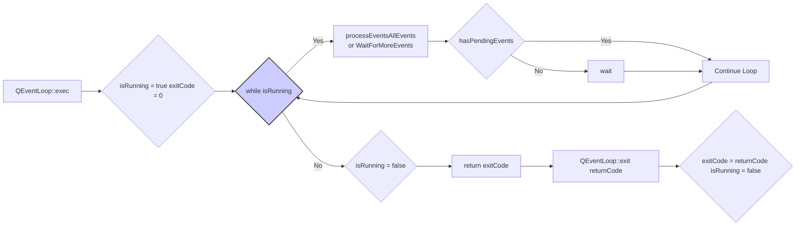
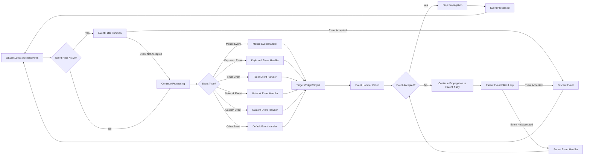

# QEventloop
## QEventLoop的本质
QEventLoop 是 Qt 事件循环的核心，它的本质就是一个循环，负责：
1. **获取事件：** 从事件队列（Event Queue）中获取事件。
2. **分发事件：** 将事件分发给对应的对象（通常是 Qt Widgets 或 QObjects）。
3. **处理事件：** 对象处理事件，可能会触发新的事件。
4. **循环往复：** 上述过程不断循环，直到循环结束。

## 核心实现
核心实现伪代码如下所示:
```cpp
class QEventLoop {
public:
    int exec() { // 进入事件循环
        isRunning = true;
        exitCode = 0;

        while (isRunning) {
            // 1. 处理 Post 事件 (Queued Connection)
            processEvents(QEventLoop::AllEvents | QEventLoop::WaitForMoreEvents);

            // 2. 如果没有事件，等待新的事件（阻塞，直到有事件发生）
            if (!hasPendingEvents()) {
               wait(); // 等待事件，实际是调用操作系统提供的机制 (如 select/epoll/kqueue/WaitForMultipleObjects)
            }
        }

        isRunning = false;
        return exitCode;
    }

    void exit(int returnCode = 0) { // 退出事件循环
        exitCode = returnCode;
        isRunning = false;
    }

private:
    bool isRunning = false;
    int exitCode = 0;

    void processEvents(QFlags<ProcessEventsFlag> flags) {
        // 获取并分发事件的逻辑
        QCoreApplication::instance()->processEvents(flags);
    }

    bool hasPendingEvents() {
        // 检查事件队列中是否有未处理的事件
        return QCoreApplication::hasPendingEvents();
    }

    void wait() {
        //调用操作系统接口等待事件的发生
        //...
    }
};

```



## processEvents
QCoreApplication::processEvents() 是事件处理的核心，它做了以下事情：

1. **获取事件：** 从事件队列中获取一个事件。 事件队列通常是一个先进先出（FIFO）的队列。
1. **事件过滤：** 应用程序可以通过 QObject::installEventFilter() 安装事件过滤器。 事件过滤器可以在事件到达目标对象之前拦截和处理事件。
1. **查找目标对象：** 确定事件的目标对象。 Qt 的事件传递机制允许事件沿着对象树传递（事件冒泡）。
1. **调用事件处理函数：** 调用目标对象的事件处理函数（例如 QWidget::event()）。
1. **事件处理函数：** 目标对象的事件处理函数负责处理事件。 它可以修改对象的状态、发送信号、创建新的事件等等。
1. **递归处理：** 如果事件处理函数导致新的事件被添加到事件队列，processEvents() 会递归地处理这些新事件。



## 使用
```cpp
#include <QThread>
#include <QEventLoop>
#include <QDebug>

class MyThread : public QThread {
    Q_OBJECT
public:
    MyThread() {}

protected:
    void run() override {
        QEventLoop eventLoop;
        qDebug() << "Thread started";

        // 执行一些任务...
        QTimer timer;
        connect(&timer, &QTimer::timeout, [&](){
            qDebug() << "Timer event in thread";
        });
        timer.start(1000); // 1 秒间隔

        eventLoop.exec(); // 启动线程的事件循环

        qDebug() << "Thread finished";
    }
};

int main(int argc, char *argv[]) {
    QCoreApplication a(argc, argv);

    MyThread thread;
    thread.start();

    // 稍后停止线程 (例如，使用 QTimer 或其他机制)
    QTimer::singleShot(5000, [&](){ // 5 秒后停止线程
        thread.quit(); // 安全地退出线程的事件循环
        thread.wait(); // 等待线程结束
        a.quit();
    });

    return a.exec(); // 主应用程序的事件循环
}

```
