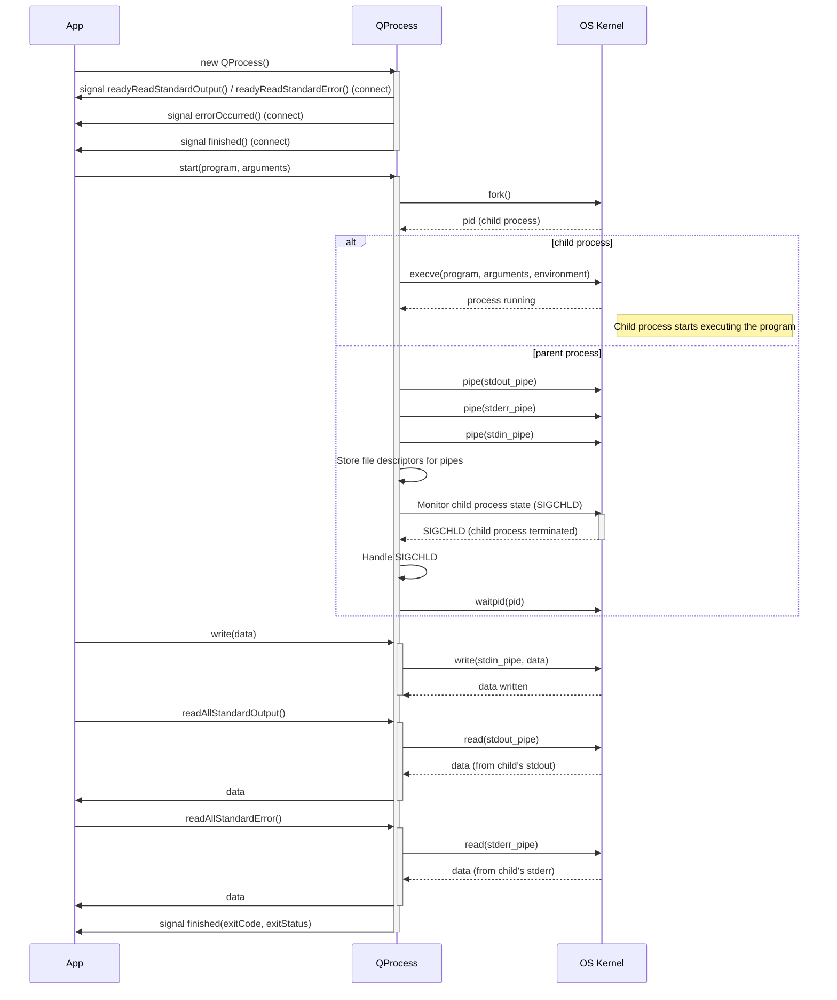
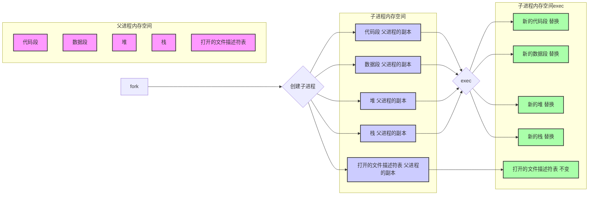

# QProcessPrivate::startProcess() 函数
是 QProcess 实现中非常关键的部分，用于启动子进程。  它包含了 fork()、管道创建和 exec() 准备等步骤。

```Cpp
void QProcessPrivate::startProcess()
{
    Q_Q(QProcess);

#if defined (QPROCESS_DEBUG)
    qDebug("QProcessPrivate::startProcess()");
#endif

    // Initialize pipes
    if (!openChannel(stdinChannel) ||
        !openChannel(stdoutChannel) ||
        !openChannel(stderrChannel) ||
        qt_create_pipe(childStartedPipe) != 0) {
        setErrorAndEmit(QProcess::FailedToStart, qt_error_string(errno));
        cleanup();
        return;
    }

    if (threadData->hasEventDispatcher()) {
        startupSocketNotifier = new QSocketNotifier(childStartedPipe[0],
                                                    QSocketNotifier::Read, q);
        QObject::connect(startupSocketNotifier, SIGNAL(activated(int)),
                         q, SLOT(_q_startupNotification()));
    }

    // Start the process (platform dependent)
    q->setProcessState(QProcess::Starting);

    // Create argument list with right number of elements, and set the final
    // one to 0.
    char **argv = new char *[arguments.count() + 2];
    argv[arguments.count() + 1] = 0;

    // Encode the program name.
    QByteArray encodedProgramName = QFile::encodeName(program);
#ifdef Q_OS_MAC
    // allow invoking of .app bundles on the Mac.
    QFileInfo fileInfo(program);
    if (encodedProgramName.endsWith(".app") && fileInfo.isDir()) {
        QCFType<CFURLRef> url = CFURLCreateWithFileSystemPath(0,
                                                          QCFString(fileInfo.absoluteFilePath()),
                                                          kCFURLPOSIXPathStyle, true);
        {
            // CFBundle is not reentrant, since CFBundleCreate might return a reference
            // to a cached bundle object. Protect the bundle calls with a mutex lock.
            static QBasicMutex cfbundleMutex;
            QMutexLocker lock(&cfbundleMutex);
            QCFType<CFBundleRef> bundle = CFBundleCreate(0, url);
            // 'executableURL' can be either relative or absolute ...
            QCFType<CFURLRef> executableURL = CFBundleCopyExecutableURL(bundle);
            // not to depend on caching - make sure it's always absolute.
            url = CFURLCopyAbsoluteURL(executableURL);
        }
        if (url) {
            const QCFString str = CFURLCopyFileSystemPath(url, kCFURLPOSIXPathStyle);
            encodedProgramName += (QDir::separator() + QDir(program).relativeFilePath(QString::fromCFString(str))).toUtf8();
        }
    }
#endif

    // Add the program name to the argument list.
    char *dupProgramName = ::strdup(encodedProgramName.constData());
    argv[0] = dupProgramName;

    // Add every argument to the list
    for (int i = 0; i < arguments.count(); ++i)
        argv[i + 1] = ::strdup(QFile::encodeName(arguments.at(i)).constData());

    // Duplicate the environment.
    int envc = 0;
    char **envp = 0;
    if (environment.d.constData()) {
        QProcessEnvironmentPrivate::MutexLocker locker(environment.d);
        envp = _q_dupEnvironment(environment.d.constData()->vars, &envc);
    }

    // Encode the working directory if it's non-empty, otherwise just pass 0.
    const char *workingDirPtr = 0;
    QByteArray encodedWorkingDirectory;
    if (!workingDirectory.isEmpty()) {
        encodedWorkingDirectory = QFile::encodeName(workingDirectory);
        workingDirPtr = encodedWorkingDirectory.constData();
    }

    // If the program does not specify a path, generate a list of possible
    // locations for the binary using the PATH environment variable.
    char **path = 0;
    int pathc = 0;
    if (!program.contains(QLatin1Char('/'))) {
        const QString pathEnv = QString::fromLocal8Bit(qgetenv("PATH"));
        if (!pathEnv.isEmpty()) {
            QStringList pathEntries = pathEnv.split(QLatin1Char(':'), QString::SkipEmptyParts);
            if (!pathEntries.isEmpty()) {
                pathc = pathEntries.size();
                path = new char *[pathc + 1];
                path[pathc] = 0;

                for (int k = 0; k < pathEntries.size(); ++k) {
                    QByteArray tmp = QFile::encodeName(pathEntries.at(k));
                    if (!tmp.endsWith('/')) tmp += '/';
                    tmp += encodedProgramName;
                    path[k] = ::strdup(tmp.constData());
                }
            }
        }
    }

    // Start the process manager, and fork off the child process.
    pid_t childPid;
    forkfd = ::forkfd(FFD_CLOEXEC, &childPid);
    int lastForkErrno = errno;
    if (forkfd != FFD_CHILD_PROCESS) {
        // Parent process.
        // Clean up duplicated memory.
        free(dupProgramName);
        for (int i = 1; i <= arguments.count(); ++i)
            free(argv[i]);
        for (int i = 0; i < envc; ++i)
            free(envp[i]);
        for (int i = 0; i < pathc; ++i)
            free(path[i]);
        delete [] argv;
        delete [] envp;
        delete [] path;
    }

    // On QNX, if spawnChild failed, childPid will be -1 but forkfd is still 0.
    // This is intentional because we only want to handle failure to fork()
    // here, which is a rare occurrence. Handling of the failure to start is
    // done elsewhere.
    if (forkfd == -1) {
        // Cleanup, report error and return
#if defined (QPROCESS_DEBUG)
        qDebug("fork failed: %s", qPrintable(qt_error_string(lastForkErrno)));
#endif
        q->setProcessState(QProcess::NotRunning);
        setErrorAndEmit(QProcess::FailedToStart,
                        QProcess::tr("Resource error (fork failure): %1").arg(qt_error_string(lastForkErrno)));
        cleanup();
        return;
    }

    // Start the child.
    if (forkfd == FFD_CHILD_PROCESS) {
        execChild(workingDirPtr, path, argv, envp);
        ::_exit(-1);
    }

    pid = Q_PID(childPid);

    // parent
    // close the ends we don't use and make all pipes non-blocking
    qt_safe_close(childStartedPipe[1]);
    childStartedPipe[1] = -1;

    if (stdinChannel.pipe[0] != -1) {
        qt_safe_close(stdinChannel.pipe[0]);
        stdinChannel.pipe[0] = -1;
    }

    if (stdinChannel.pipe[1] != -1)
        ::fcntl(stdinChannel.pipe[1], F_SETFL, ::fcntl(stdinChannel.pipe[1], F_GETFL) | O_NONBLOCK);

    if (stdoutChannel.pipe[1] != -1) {
        qt_safe_close(stdoutChannel.pipe[1]);
        stdoutChannel.pipe[1] = -1;
    }

    if (stdoutChannel.pipe[0] != -1)
        ::fcntl(stdoutChannel.pipe[0], F_SETFL, ::fcntl(stdoutChannel.pipe[0], F_GETFL) | O_NONBLOCK);

    if (stderrChannel.pipe[1] != -1) {
        qt_safe_close(stderrChannel.pipe[1]);
        stderrChannel.pipe[1] = -1;
    }
    if (stderrChannel.pipe[0] != -1)
        ::fcntl(stderrChannel.pipe[0], F_SETFL, ::fcntl(stderrChannel.pipe[0], F_GETFL) | O_NONBLOCK);

    if (threadData->eventDispatcher) {
        deathNotifier = new QSocketNotifier(forkfd, QSocketNotifier::Read, q);
        QObject::connect(deathNotifier, SIGNAL(activated(int)),
                         q, SLOT(_q_processDied()));
    }
}
```
## 代码流程分析:
### 初始化管道 (Pipes):
openChannel() 用于为标准输入 (stdin)、标准输出 (stdout) 和标准错误 (stderr) 创建管道。 qt_create_pipe() 实际上调用底层的 pipe() 系统调用。
childStartedPipe 用于父进程接收子进程启动成功的通知。
### 启动通知 (Startup Notification):
如果存在事件分发器，会创建一个 QSocketNotifier 来监听 childStartedPipe 的读取事件。 QSocketNotifier 允许 Qt 的事件循环在文件描述符（例如管道）上有数据可读时发出信号。
_q_startupNotification() 槽函数会在子进程启动后被调用。
### 设置进程状态 (Process State):

q->setProcessState(QProcess::Starting) 设置 QProcess 的状态为 Starting。
### 构建参数列表 (Argument List):

分配内存来存储参数列表 (argv)，包括程序名和参数。 argv 必须以 NULL 结尾。
使用 QFile::encodeName() 将程序名和参数转换为适合系统调用的编码格式。
使用 strdup() 复制程序名和参数的字符串。 重要: 这些字符串必须是独立的，因为子进程会使用它们。
### 处理环境变量 (Environment Variables):

_q_dupEnvironment() 用于复制环境变量。
QProcessEnvironment 提供了管理进程环境变量的接口。
### 处理工作目录 (Working Directory):

如果指定了工作目录，则将其编码并传递给子进程。
### 查找程序路径 (Program Path):

如果程序名不包含路径（例如，只是 "ls"），则会使用 PATH 环境变量来查找程序的可执行文件。
forkfd() 系统调用：

这是关键的一步。  forkfd() 实际上执行 fork() 系统调用来创建子进程。  forkfd 的返回值用于指示当前进程是父进程还是子进程。

forkfd 带有 FFD_CLOEXEC 标志，这是为了确保子进程在执行 exec 之后，父进程创建的文件描述符都会被关闭，防止文件描述符泄露。

### 子进程 (Child Process):

如果 forkfd 返回 FFD_CHILD_PROCESS，则表示当前代码在子进程中执行。
execChild() 函数 (未在此代码片段中提供) 负责执行以下操作：
关闭不需要的文件描述符（例如管道的父进程端）。
使用 dup2() 系统调用将管道重定向到标准输入、标准输出和标准错误。
调用 execv() (或类似的函数) 来替换进程映像。
如果 execv() 失败，则调用 _exit() 退出子进程。
父进程 (Parent Process):

如果 forkfd 返回其他值（例如 0 或正数），则表示当前代码在父进程中执行。
父进程会关闭不需要的文件描述符。
父进程会将管道设置为非阻塞模式，以便可以异步读取数据。
父进程会创建一个 QSocketNotifier 来监听子进程的死亡信号（_q_processDied() 槽函数）。
### 清理 (Cleanup):

父进程会释放分配的内存，例如参数列表和环境变量的副本。
## 关键点总结:

fork() 创建子进程: forkfd() (内部调用 fork()) 是创建子进程的关键。
管道用于通信: 管道用于父进程和子进程之间的标准输入、标准输出和标准错误流的通信。
exec() 替换进程映像: execChild() 内部会调用 execv() (或类似的函数) 来使用新的程序替换子进程的内存空间。
QSocketNotifier 用于事件处理: QSocketNotifier 用于监听管道上的数据和子进程的死亡信号，并将这些事件传递给 Qt 的事件循环。
内存管理: 父进程负责释放分配的内存。
关于 forkfd()

forkfd()  是一个非标准的函数，它并非 POSIX 标准的一部分。它通常用于在 fork 之后立即创建一个文件描述符，该文件描述符在子进程中关闭（使用 FD_CLOEXEC 标志）。这可以用来同步父进程和子进程，或者在 exec 之前进行一些设置。



