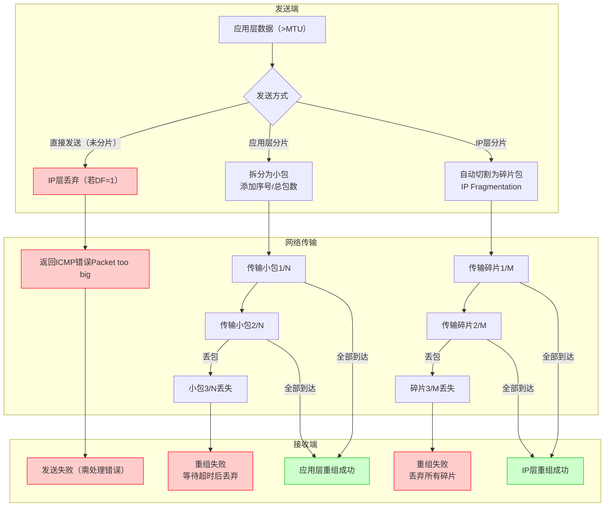
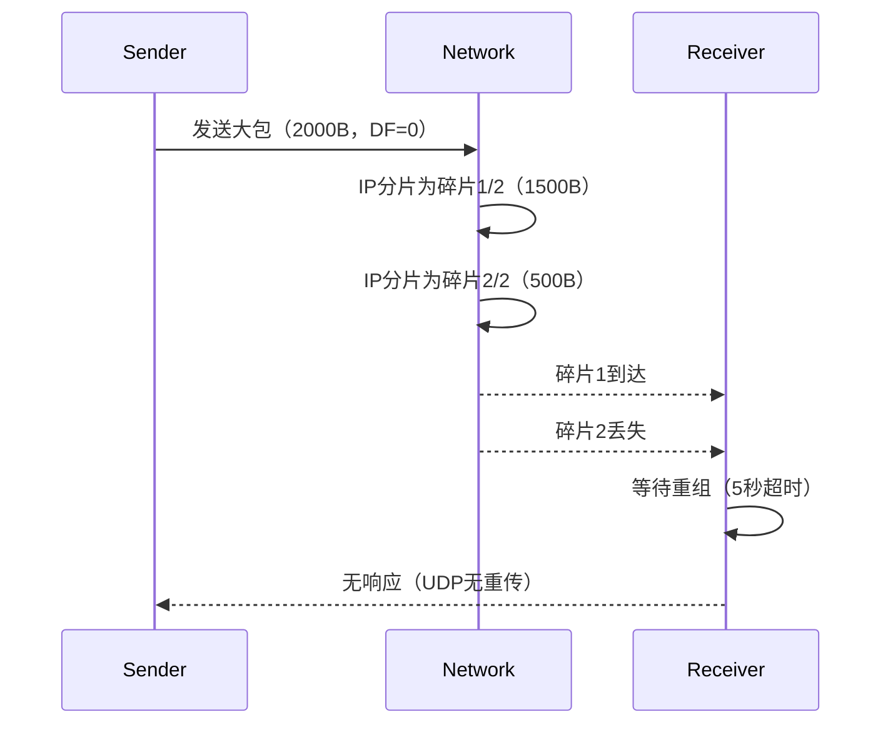

# 301远程编程列表为空


## 抓包排查
通过Wireshark抓包 客户端有发送对应的数据包至指定端口
对应的发送逻辑处理也很简单，服务端解析请求并相应

但是抓包发现对应的端口并没有响应发出

通过命令
```bash
netstat -tuln |greo :7124
```
发现运行的端口确实为检测软件 排除其他软件占用端口的情况

## 加日志
在上述步骤无法继续排查问题的情况下，决定对服务端以及客户端的代码关键节点添加日志
1. 添加UDP bind时的异常判断
1. 添加UDP发送数据包时的打印
1. 添加客户端发送数据包的打印
1. 添加服务端收到请求的日志打印

在添加上述步骤以后，实施至客户现场，发现在请求发送，请求处理，请求响应均有日志打印

但是对于响应的信息内容超长，有8W+字符，初步判断为发送失败

## 详细原因分析
1. 客户现场的板式文件有1k+
1. 服务端返回结果时，首先拿到板式文件夹下的所有板式文件夹名称，拼接为json返回，当板式名较长时，数据量很大


查阅QT源码得知，服务端响应所调用的接口writeDatagram上限大小为512字节，超出就会导致发送到达之前被IP层碎片化，影响内容甚至是发送失败

### UDP数据包的大小限制
**理论最大值：**
65507字节：根据UDP协议定义，其包头中的16位长度字段决定了单次发送的最大理论长度为2^16−1 = 65535字节。
扣除UDP头（8字节）和IP头（20字节）后，实际应用层数据最大为 65507字节。
操作系统限制：若发送的数据超过65507字节，系统调用（如send或sendto）会返回错误码EMSGSIZE（Message too long）
**实际推荐值：**
以太网环境：建议不超过1472字节（MTU 1500字节 - IP头20字节 - UDP头8字节）。
互联网环境：因标准MTU为576字节，推荐控制在548字节以内（576 - IP头20 - UDP头8）。

### 如何查看相关限制
**查看MTU**

```bash
ping -f -l <size> <目标IP>

ifconfig
```

- ​    命令检测：通过查看当前网络MTU值。例如，ping -f -l 1472 www.bing.com若提示需要分片，则说明MTU小于1500 。
- ​    系统文件：在Linux中，UDP发送缓冲区默认值可通过cat /proc/sys/net/core/wmem_default查看 。

**查看协议限制**
    UDP最大长度由协议栈实现决定，可通过编程接口（如getsockopt）查询缓冲区大小限制。

### 限制原因
**协议设计**
    UDP包头中的16位长度字段限制了数据包总长度不超过65535字节。
**网络层限制**
    IP层分片（Fragmentation）虽允许发送大包，但分片后若任一碎片丢失，整个数据报会被丢弃，UDP的不可靠性会放大此问题。
**链路层MTU**
    数据链路层（如以太网）的MTU限制为1500字节，超过则需分片，否则数据包可能被丢弃。

### 解决发送过大的问题
**应用层分片与重组**
    将数据拆分为多个小包，添加序列号和总包数信息，接收端按序重组。
**启用UDP GSO（Generic Segmentation Offload）**
    通过协议栈或网卡硬件自动分片，降低CPU负载（需内核和网卡支持）。
**调整MTU或协议**
    增大本地MTU（需网络设备支持），或改用TCP协议（支持流式传输和自动分片）。
**启用PMTUD（Path MTU Discovery）**
    动态探测路径最小MTU，避免分片（需设置DF标志位） 。





## 复盘
1. 在加日志时，不仅要打印输出的信息，还要添加发送状态结果的打印
2. 阅读源码不够仔细，只注意了消息的发送，没有关心到消息的来源以及整个链路
