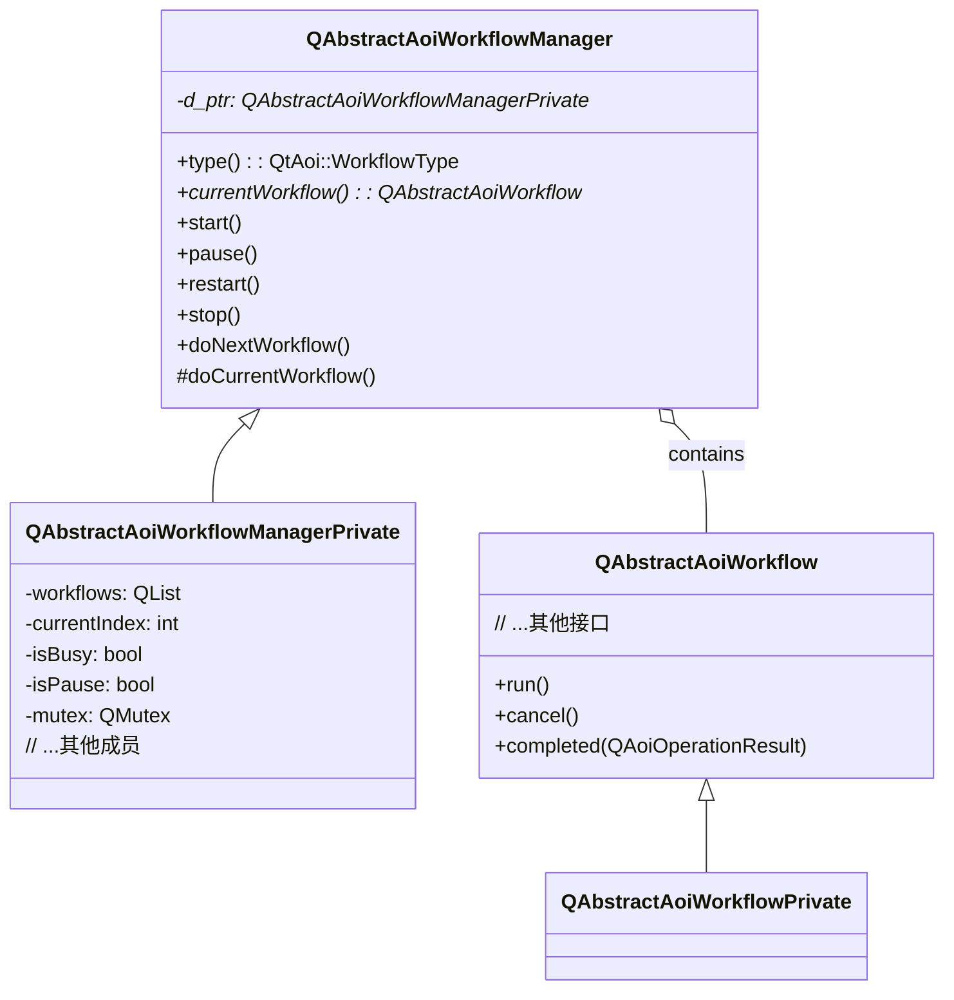
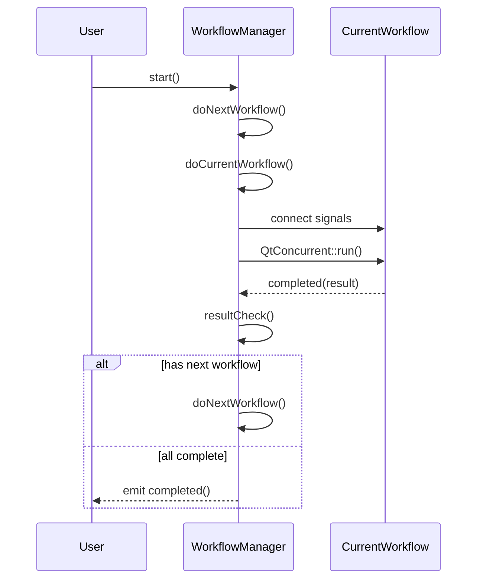
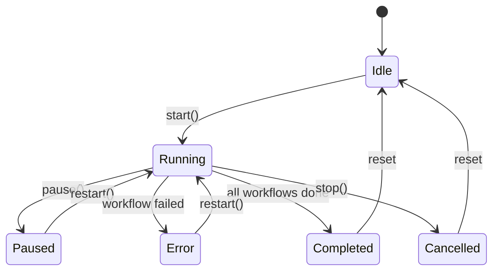
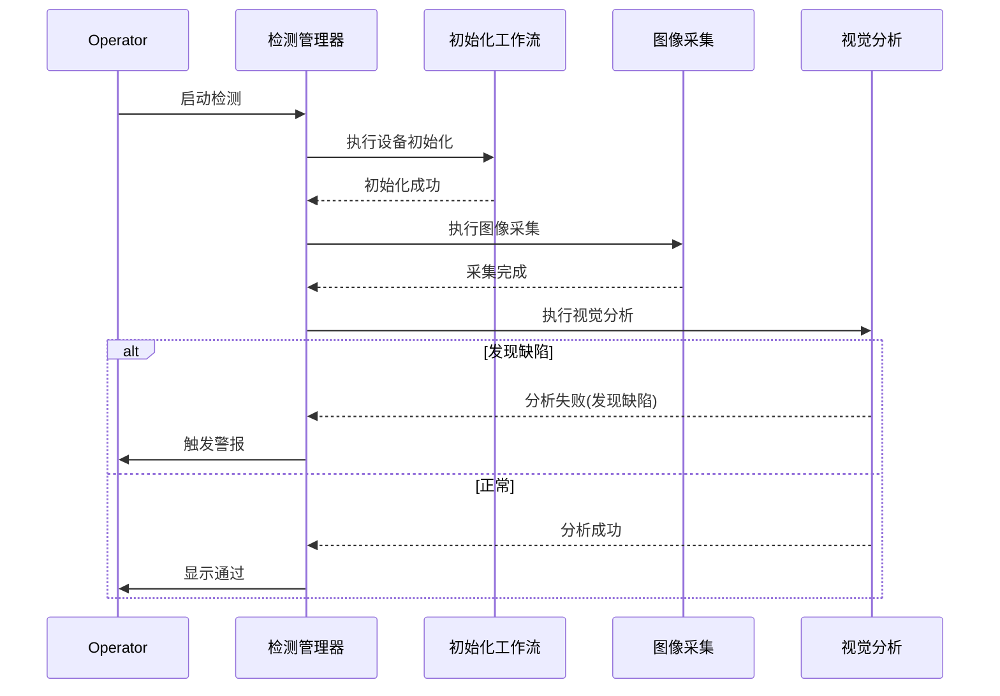
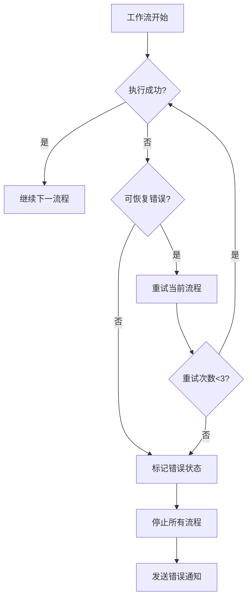

## 类图



## 时序图



- 这是一个基于Qt框架实现的异步工作流管理系统
- 采用经典的Pimpl模式实现接口与实现的分离
- 通过工作流队列（workflows）管理多个检测流程
- 主要特点：
  - 支持顺序执行工作流
  - 支持暂停/恢复/取消操作
  - 具备错误处理机制
  - 支持跨线程操作（使用QMutex保证线程安全）
  - 提供进度反馈机制（processMessage/processTime信号）

## 状态转换图



- 采用观察者模式：通过信号槽机制实现工作流状态通知
- 使用QtConcurrent实现异步执行
- 通过索引(currentIndex)控制流程进度
- 错误处理采用结果检查机制（resultCheck）
- 支持工作流重用（通过isloop标志控制循环执行）
- 提供完整的生命周期管理（start/pause/stop/restart）

## 场景

以下是一个典型的AOI（自动光学检测）应用场景及对应的代码用例，使用这个工作流框架实现PCB板检测流程：

# 场景描述：PCB电路板自动光学检测

1. 流程步骤：
   - 设备初始化 → 传送带定位 → 图像采集 → 视觉分析 → 结果导出 → 复位设备
2. 异常处理需求：
   - 出现硬件故障时自动重试
   - 连续3次失败后停止流程
   - 支持操作员手动暂停/继续



``` cpp
// 自定义工作流 - 图像采集
class ImageCaptureWorkflow : public QAbstractAoiWorkflow {
    Q_OBJECT
public:
    explicit ImageCaptureWorkflow(QObject* parent = nullptr)
        : QAbstractAoiWorkflow("ImageCapture", parent) {}

protected:
    void run() override {
        setProcessMessage("开始图像采集...");

        // 模拟采集过程
        for(int i=0; i<10; i++){
            if(isCancelRequested()) break;
            QThread::msleep(500);
            setProcessMessage(QString("采集进度 %1/10").arg(i+1));
        }

        // 随机生成测试结果
        bool success = QRandomGenerator::global()->bounded(10) > 2;
        setCompleted(success ?
            QAoiOperationResult::success() :
            QAoiOperationResult::error("CAMERA_TIMEOUT", "相机响应超时"));
    }
};

// 主程序逻辑
int main(int argc, char *argv[]) {
    QApplication app(argc, argv);

    // 创建管理器
    QAbstractAoiWorkflowManager manager;
    manager.setType(QtAoi::WorkflowType::Inspection);

    // 构建检测流程
    manager.append(new DeviceInitWorkflow());    // 设备初始化
    manager.append(new ConveyorPositioning());  // 传送带定位
    manager.append(new ImageCaptureWorkflow()); // 图像采集
    manager.append(new VisualAnalysis());       // 视觉分析
    manager.append(new ReportExportWorkflow()); // 结果导出

    // 连接信号
    QObject::connect(&manager, &QAbstractAoiWorkflowManager::processMessage,
        [](const QString& msg){ qDebug() << "[系统]" << msg; });

    QObject::connect(&manager, &QAbstractAoiWorkflowManager::completed,
        [](const QAoiOperationResult& result){
            qDebug() << (result.isSuccess() ? "检测完成" : "检测终止");
        });

    // 启动流程
    manager.start();

    // 模拟用户操作
    QTimer::singleShot(3000, [&]{ manager.pause(); });  // 3秒后暂停
    QTimer::singleShot(5000, [&]{ manager.restart(); }); // 5秒后继续

    return app.exec();
}

```


